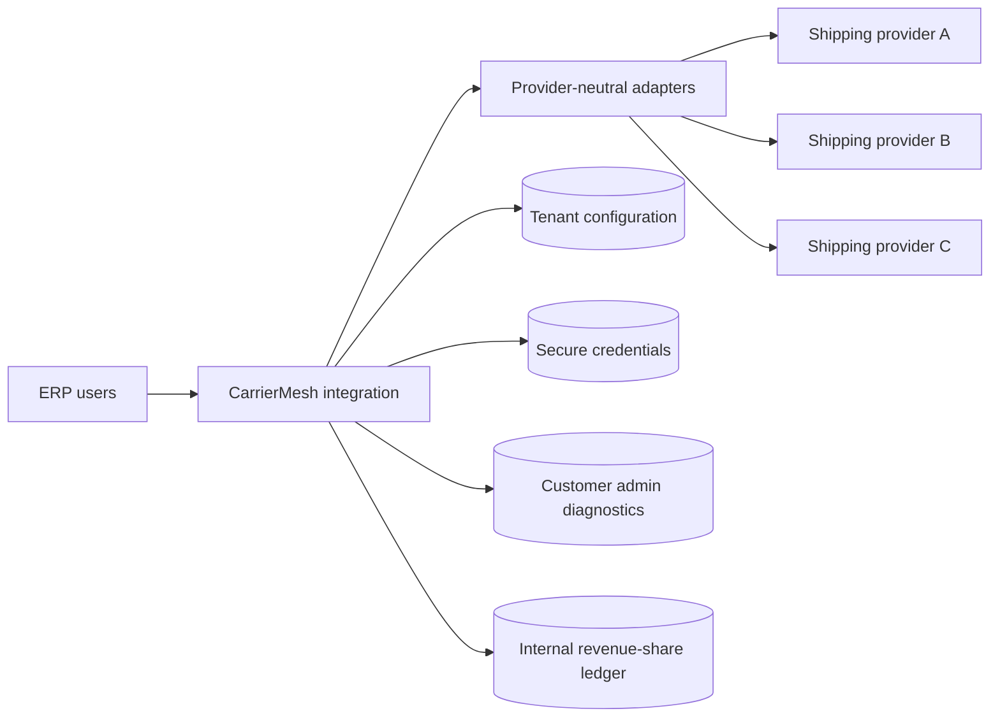

# CarrierMesh

**Provider-neutral ERP shipping integration — an independent engineering-management portfolio case study.**

This independent architecture case study draws on experience delivering enterprise shipping integrations in a production ERP environment, while exploring a generalized multi-provider design.

> **Independent portfolio case study — concept and product design, not a live service.** CarrierMesh is a hypothetical ERP shipping-integration concept developed to demonstrate product thinking, requirements definition, provider-neutral architecture, security design, and engineering trade-offs. The documentation describes a proposed implementation, not a production deployment. Shipping-provider capabilities, commercial arrangements, and performance have not been validated or guaranteed.

> **Status:** Product requirements and solution design are documented; CarrierMesh has not been implemented or released. This independent case study is not affiliated with, or endorsed by, any employer or shipping provider.

## The challenge

ERP customers may connect multiple third-party shipping aggregators. Each provider has different authentication, carrier-account identifiers, service capabilities, and transaction behavior. CarrierMesh explores a unified ERP workflow while preserving provider-specific data and financial safety.

## Product scope

- Customer-owned shipping accounts and direct customer-to-provider billing
- Provider-specific authorization behind one ERP onboarding experience
- Capability-driven carrier/service discovery and customer-admin restrictions
- Concurrent cross-provider rate shopping with normalized results
- Outbound and return labels, including supported multi-package shipments
- Safe reconciliation for uncertain label-purchase outcomes
- Eligibility-based manifests, address validation, and on-demand tracking
- Basic international customs information and selected optional parcel services
- Customer-admin access to sanitized API diagnostics
- Separate ERP-internal revenue-share audit records

## Architecture at a glance

## Documents

- [Product Requirements Document](docs/product/product-requirements.md)
- [Design decision log](docs/product/decision-log.md)
- [Integration architecture](docs/architecture/diagrams/01-architecture.mmd)
- [Customer onboarding](docs/architecture/diagrams/02-onboarding.mmd)
- [Rate shopping and label creation](docs/architecture/diagrams/03-rate-label.mmd)
- [Purchase recovery](docs/architecture/diagrams/04-purchase-recovery.mmd)
- [Audit/access boundaries](docs/architecture/diagrams/05-audit-access.mmd)

## Engineering trade-offs

The PRD documents **36 product design decisions**, including avoiding blind purchase retries; customer-direct billing; server-side tenant isolation; and deferring formal performance SLOs until operational baselines are measured.

## Next steps

Validate third-party provider capabilities and partner agreements, define adapter interfaces, implement a mock provider harness, and add automated acceptance tests.

**Publication disclaimer:** No production credentials, actual customer payloads, or employer-confidential material should be added to this repository.
