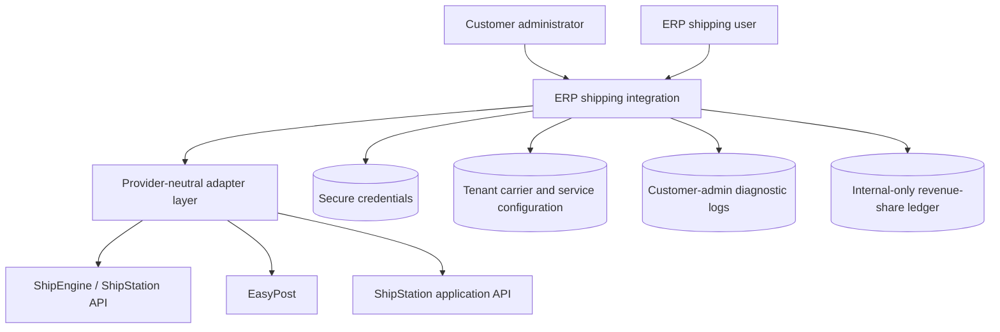
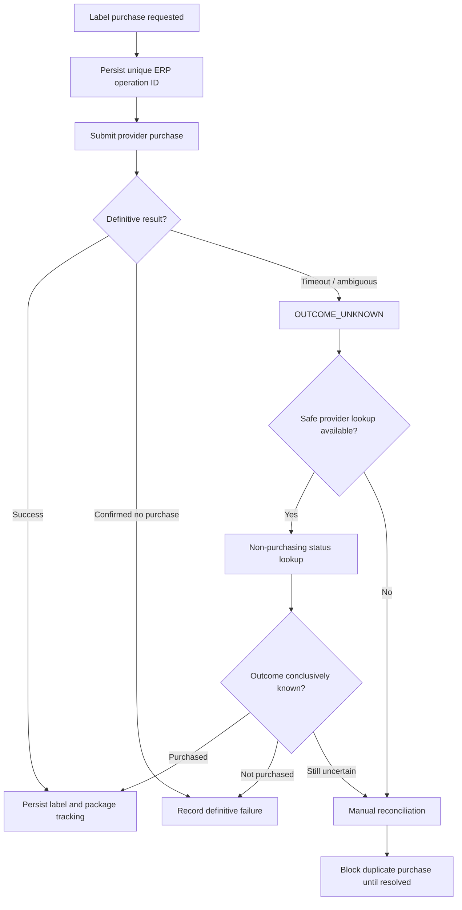
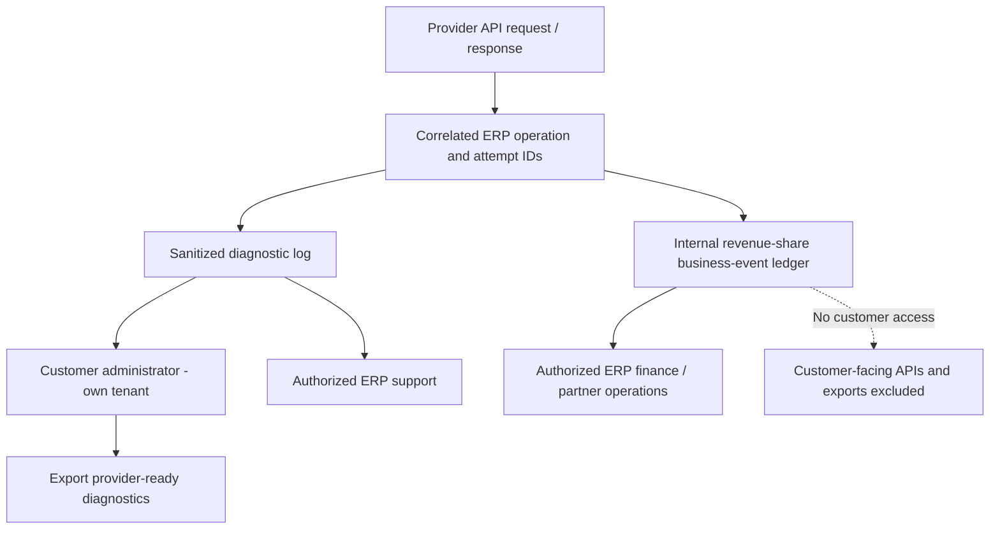

# CarrierMesh — Product Requirements Document

**Version:** 0.4 · **Date:** October 30, 2026 · **Status:** Draft for review

> **Independent hypothetical portfolio case study.** CarrierMesh is not a deployed shipping integration. The agreed decisions represent this design exercise, not approvals or verified capabilities of any shipping provider.

[← Project overview](../../README.md) · [Decision index](decision-log.md) · [Mermaid source diagrams](../architecture/diagrams/01-architecture.mmd)

## Contents

- [1. Executive summary](#1-executive-summary)
- [2. Customer and user context](#2-customer-and-user-context)
- [3. Goals and measures](#3-goals-and-measures)
- [4. Product scope](#4-product-scope)
- [5. Domain definitions](#5-domain-definitions)
- [6. End-to-end user journeys](#6-end-to-end-user-journeys)
- [7. Functional requirements](#7-functional-requirements)
- [8. Business rules and cross-cutting invariants](#8-business-rules-and-cross-cutting-invariants)
- [9. Non-functional requirements — PROPOSED for review](#9-non-functional-requirements-proposed-for-review)
- [10. Acceptance criteria and release gate](#10-acceptance-criteria-and-release-gate)
- [11. Risks and trade-offs](#11-risks-and-trade-offs)
- [12. Engineering / product trade-offs demonstrated](#12-engineering-product-trade-offs-demonstrated)
- [13. Dependencies and assumptions](#13-dependencies-and-assumptions)
- [14. Release sequencing — PROPOSED](#14-release-sequencing-proposed)
- [15. Design decisions resolved; remaining implementation verification](#15-design-decisions-resolved-remaining-implementation-verification)
- [16. Decision D-018 — Customer-direct provider billing (AGREED)](#16-decision-d-018-customer-direct-provider-billing-agreed)
- [17. Decision D-019 — Credential and carrier configuration persistence (AGREED)](#17-decision-d-019-credential-and-carrier-configuration-persistence-agreed)
- [18. Decision D-020 — ERP-integrator-only revenue-share audit (AGREED)](#18-decision-d-020-erp-integrator-only-revenue-share-audit-agreed)
- [19. Decision D-021 — Customer-admin API diagnostic logs (AGREED)](#19-decision-d-021-customer-admin-api-diagnostic-logs-agreed)
- [20. Agreed Design Decisions D-022 through D-036 — v0.4](#20-agreed-design-decisions-d-022-through-d-036-v04)
- [21. Incremental V1 Requirements and Acceptance Criteria](#21-incremental-v1-requirements-and-acceptance-criteria)

---


Product Requirements Document (PRD) | Engineering Management Portfolio Case Study | Version 0.4 | October 30,
2026

Attribute                           Value

Version                             0.4

Date                                October 30, 2026

Status                              Draft for review

Document type                       Provider-neutral Product Requirements Document

Product context                     Hypothetical integration with an existing ERP

Decision source                     Thirty-six agreed product design decisions (D-001–D-036)

Intended readers                    Product managers, engineering managers, architects, QA, UX, technical support

Disclosure: This independent portfolio case study does not describe an existing vendor's implementation or make
claims about any shipping provider's specific API support. Requirements are categorized as AGREED, PROPOSED, or
OPEN. "Agreed" means agreed within this design exercise, not approved by an actual customer or engineering
organization.

### Figure 1 — Provider-neutral integration and separated access boundaries



## 1. Executive summary

### 1.1 Problem

An ERP customer may use multiple third-party shipping aggregators to access carriers and negotiate different
services or rates. Direct integrations to individual providers can lead to duplicated ERP user experiences, provider-
specific data handling, inconsistent error messages, and expensive ongoing integration maintenance.

### 1.2 Product vision

Provide one consistent ERP shipping experience through a provider-neutral shipping integration contract.
Each ERP customer connects their own aggregator account(s), configures carrier relationships at those aggregators,
and performs key shipping operations from the ERP. The ERP can compare rates across aggregators without tying
downstream transactions to the customer's current default provider.

### 1.3 Core product principles

1.    Provider neutrality: ERP workflows consume common business concepts; adapters translate provider-

specific operations.

2.    Customer ownership: Customers control their own aggregator accounts and carrier relationships.

Customer-direct billing (D-018 — AGREED): The ERP customer owns the billing relationship with its shipping
aggregator and/or carrier. The ERP integrator does not collect shipping charges, fund accounts, hold payment
details, or become merchant of record.

Security and support boundaries (D-019–D-021 — AGREED): Provider credentials are protected; customer
administrators can inspect sanitized, tenant-scoped API diagnostics; revenue-share records are internal to the ERP
integrator and never customer-visible.

3.    No silent financial side effects: Rate shopping never buys labels; uncertain label/void outcomes are

reconciled rather than blindly retried.

4.    Clear boundaries: Purchasing a label, receiving tracking updates, voiding a label, or generating a manifest

never automatically completes an ERP fulfillment.

5.    Explicit consent for consequential changes: The user must opt into address-warning overrides, alternate

providers for linked returns, and any manual split of unsupported multi-package shipments.

6.    Traceable decisions: The originating connection, carrier account, transaction references, and audit

history persist throughout a shipment's lifecycle.

## 2. Customer and user context

### 2.1 Primary personas

Persona                        Goal                                  Challenges addressed

Configure accounts and available
Shipping administrator                                               Multiple vendors, credentials, account isolation
carrier services

Warehouse / fulfillment        Get rates, create and print labels,
Repetitive steps, unclear failures, duplicate labels
operator                       track shipments

Compare costs and delivery options;
Shipping coordinator                                                 Comparing rates from different aggregators
produce manifests

Customer service               Find shipment status and return       Provider-specific terminology and disconnected
representative                 documentation                         history

Govern permissions, integration
ERP administrator                                                    Security, troubleshooting, multi-tenant correctness
reliability, audit trails

### 2.2 Jobs to be done

- When I prepare a fulfillment, I want to compare shipping offers from my connected aggregators so I can
choose an appropriate service without leaving the ERP.

- When I know the carrier and service I want, I want to generate a label directly rather than being forced to
rate shop first.

- When a purchase times out, I need to know whether it may have completed so I do not buy the same label
twice.

- When I close out shipping, I want manifests to include exactly the eligible labels I selected.

- When I process a return, I want to use the original provider by default but retain the ability to use another
connected provider.

## 3. Goals and measures

### 3.1 V1 goals — AGREED direction

- Enable a consistent ERP experience for connecting customer-owned shipping aggregators.

- Support cross-aggregator rate shopping from a single ERP rate request.

- Support outbound and return label operations with auditable ERP records.

- Preserve multi-package shipment identities, provider routing, and fulfillment independence.

- Provide understandable handling for unsupported capabilities and partial provider failures.

### 3.2 Candidate success indicators — PROPOSED; targets not yet set

Dimension                            Candidate measure

Adoption                             Percentage of eligible ERP customers with an active shipping connection

Task efficiency                      Median operator time from opening shipment to retrieving/printing labels

Rate shopping                        Percentage of requests yielding at least one eligible comparable rate

Reliability                          Rate of label purchases requiring manual reconciliation

Financial safety                     Duplicate label charges attributable to ERP retries (desired: zero)

Supportability                       Support contacts per 1,000 shipping operations

Operational completeness             Percentage of eligible manifest batches closed without manual correction

Measurement note: These indicators are not claimed outcomes. Baselines, instrumentation, and numeric targets
are a proposed discovery and release-readiness activity.

## 4. Product scope

### 4.1 In scope for V1 — AGREED

Area                                 V1 scope

Customer connects their own supported aggregator account; multiple connections
Account connection
supported

Carrier discovery                    ERP retrieves carrier accounts/services configured externally in the aggregator

One flexible getRates business operation supports single and multiple carriers and
Rating
multiple aggregator connections

Area                                 V1 scope

Rate presentation                    Requests run concurrently; display results after all respond or an overall deadline

Generate from selected quote or directly from carrier/service; support multi-package
Outbound labels
shipments

Reject unsupported multi-package services; never silently split into independent
Multi-package restriction
shipments

Linked or standalone; default linked return to original provider; allow compatible
Returns
alternate provider

Voiding                              Entire single- or multi-package shipment only; no partial multi-package voids

Manifests                            Explicit selection or criteria-based selection, both resolved by ERP to exact label IDs

Address validation                   On-demand and pre-label; allow explicit override of warnings/unverified, block invalid

Tracking                             On-demand only, for integration-created outbound and return shipments

Fulfillment                          Shipping operations do not automatically complete ERP fulfillment or adjust inventory

Billing ownership                    Customer contracts and pays directly through its provider/carrier
arrangements; ERP initiates authorized shipping operations but never collects
provider shipping charges (D-018).

Credential and carrier reference management: Secure partner/customer credentials where applicable; retain
tenant-scoped provider, account, carrier-account and service identifiers, defaults and historical origin identifiers.

Internal revenue-share auditability: Capture provider-attributed, idempotent business events for future ERP-
integrator-only reconciliation; customers cannot view revenue-share data.

Customer-admin diagnostics: Search, inspect and export sanitized provider API request/response logs within the
customer tenant; sensitive headers and payment details never exposed.

### 4.2 Explicitly out of scope for V1 — AGREED

- ERP-managed carrier credential setup and required partner-funded account provisioning. Provider-hosted
customer authorization is supported where available (D-036).

ERP-integrator billing, reseller billing, payment collection, hosted provider checkout, customer payment-method
storage, and partner-funded shipping balances (D-018).

- Automatic splitting of an unsupported multi-package request into separately purchased shipments.

- Individual-package voiding within a carrier-recognized multi-package shipment.

- Automated tracking webhooks, background polling, or tracking reconciliation.

- Tracking shipments created outside the integration using an arbitrary tracking number.

- Automatic completion or cancellation of ERP fulfillment, or automatic inventory posting, based on label or
tracking events.

Automated commission calculation, provider statement ingestion, revenue-share payout dashboards and dispute
workflows (D-020); V1 captures audit events only.

### 4.3 Previously open scope boundaries — RESOLVED (D-022 to D-036)

- Basic international shipping and provider-supported customs declarations/documents included in V1;
advanced compliance and ERP-calculated duties/landed cost deferred (D-026).

- Selected parcel extras such as signature, insurance and Saturday delivery included when supported;
hazardous goods, COD and freight/LTL deferred (D-027).

- Multi-package returns supported where provider/carrier permits; provider-reported charges and refund
status shown without ERP billing (D-028–D-029).

- Customer-admin carrier/service restrictions enforced in backend; advanced conditional policies deferred
(D-023).

- Show original currency and estimated conversion using documented FX source and timestamps; flag
incomplete charge coverage (D-030).

- Address validation technical unavailability permits explicit authorized override, without overriding known
INVALID or provider-mandated validation (D-024).

All original product-boundary questions have agreed decisions D-022–D-036. Provider certification, commercial
terms and acceptance tests remain implementation dependencies, not assumptions of universal provider support.

## 5. Domain definitions

Term                              Meaning

ERP customer / tenant             Business using the ERP, with isolated shipping configuration and data

Aggregator                        External shipping service providing access to one or more carriers

Connection                        Tenant-owned configuration authorizing access to one aggregator account

Carrier account                   Carrier relationship configured inside the aggregator; not an ERP-managed credential

Carrier service                   Shipping option offered through a carrier account

Shipping quote                    Provider-issued, time-sensitive offer or estimate for a particular shipment description

Logical shipment                  ERP shipping operation containing one or more packages

Individually identified physical package with its own measurements and possible
Package
label/tracking number

Label group                       Label(s) created through a logical shipment; voided as a whole in V1

Manifest                          Provider/carrier document closing or grouping an exact set of eligible labels

Host ERP record whose state and inventory effects remain controlled by existing ERP
ERP fulfillment
logic

## 6. End-to-end user journeys

### Figure 2 — Customer onboarding and authorization handoff

```mermaid
sequenceDiagram
  actor Admin as Customer administrator
  participant ERP as ERP
  participant Provider as Shipping provider
  participant Vault as Secure credential store
  Admin->>ERP: Select certified provider
  alt Hosted authorization available
    ERP->>Provider: Redirect for registration / authorization
    Provider-->>ERP: Authorization result
  else API key required
    Admin->>ERP: Enter provider-issued API key
  end
  ERP->>Provider: Validate customer-scoped authorization
  Provider-->>ERP: Customer account identity
  ERP->>Vault: Store secret or reference
  ERP->>Provider: Discover connected carriers and services
  Provider-->>ERP: Account-scoped carrier and service identifiers
  ERP-->>Admin: Configure allowed services; activate connection
```

#### J-01 Connect provider and select shipping services

1.    Shipping administrator selects a supported aggregator type and enters the appropriate authorization

details.

Customer registers or signs in directly with that aggregator and configures the required billing/payment
relationship outside the ERP; the ERP may link to provider-hosted onboarding but does not collect payment data.

The customer authorizes the ERP integration using a provider-supported customer credential or delegated
authorization mechanism; customer account provisioning by the ERP integrator is not mandatory.

2.    ERP checks authorization against the aggregator and records the connection under the correct tenant.

3.    ERP retrieves eligible carrier accounts and services already configured by the customer at the aggregator.

4.    Administrator can refresh and choose which connections/services are available for ERP shipping.

5.    Historical shipping records preserve their original connection even if the default changes or a connection

is disconnected.

J-01A Administer credentials and carrier configuration

1. An authorized ERP administrator connects a customer-owned provider account through a provider-supported

authorization method; any partner integration credential is managed separately and never displayed.

2. ERP securely stores or references credentials and maps the tenant/provider connection to external customer,

carrier-account, carrier and service identifiers.

3. ERP retrieves and refreshes available carrier accounts and service metadata; administrator can select permitted

defaults without losing historic provider identifiers.

4. Credential rotation, revocation or disconnect blocks inappropriate future operations while preserving historical

shipment references.

### Figure 3 — Concurrent rate shopping and selected-label purchase

```mermaid
sequenceDiagram
  actor User as Shipping user
  participant ERP as ERP shipping service
  participant A as Provider A
  participant B as Provider B
  User->>ERP: Request rates
  par Rate A
    ERP->>A: Get rates
    A-->>ERP: Rates / error
  and Rate B
    ERP->>B: Get rates
    B-->>ERP: Rates / timeout
  end
  ERP-->>User: Normalized offers; PARTIAL if needed
  User->>ERP: Confirm label purchase
  ERP->>ERP: Create durable purchase operation
  ERP->>A: Purchase through selected originating connection
  A-->>ERP: Label response or uncertain outcome
  ERP-->>User: Label or reconciliation status
```

#### J-02 Compare rates across connected aggregators

1.    Operator supplies sender/recipient details, ship date, package descriptions, and optional carrier filters.

2.    ERP validates input, identifies selected eligible connections, and dispatches provider requests

concurrently.

3.    ERP waits for all responses or a configurable global deadline.

4.    ERP normalizes successful results, keeps separate offers from the same carrier through different

aggregators, and reports failed/timed-out sources.

5.    Operator selects an eligible quote, or abandons rating without side effects.

#### J-03 Purchase an outbound label

1.    Operator starts from a fulfillment or suitable ERP shipping context.

2.    Operator chooses a previous rate or selects aggregator, carrier account, and service directly.

3.    ERP verifies addresses, package descriptions, support for multi-package shipment, and quote consistency

when applicable.

4.    ERP records an operation identity before the external purchase request.

5.    Provider adapter creates one logical shipment with one or more package labels.

6.    ERP stores label and tracking references, cost and document access without completing fulfillment.

7.    If outcome is uncertain, ERP records it for reconciliation and does not blindly repurchase.

#### J-04 Create a return label

1.    Operator starts from an existing outbound shipment or opens a standalone return request.

2.    Linked return defaults to original provider but may use another compatible connection.

3.    Operator reviews reverse-direction addresses, package details, service, and reference to any return

authorization.

4.    ERP creates a return label through the selected provider, preserving both the return's actual provider and

its original ERP shipment link (if any).

5.    No inventory receipt or refund is posted solely because a return label was created.

#### J-05 Void an existing label group

1.    Operator requests void for a single-package shipment or an entire multi-package shipment.

2.    ERP resolves the original connection; validates carrier/provider restrictions and prior status.

3.    ERP submits the void without switching providers or splitting the request into package voids.

4.    ERP records accepted, rejected, or uncertain state. Refund settlement is separate from void acceptance.

5.    ERP fulfillment and inventory status are unchanged.

#### J-06 Generate a manifest

1.    Operator selects explicit ERP labels or provides warehouse/date/carrier filters.

2.    ERP resolves criteria to an exact eligible label set, preserving full multi-package groups.

3.    ERP groups labels as required by originating connection, carrier, origin and date.

4.    ERP submits exact provider label references to the applicable adapter; an adapter must not broaden the

selection silently.

5.     ERP records manifests, included labels, errors and document references.

#### J-07 Validate address and check a shipment

1.     User may validate addresses directly from ERP screens.

2.     Before purchasing outbound or return labels, ERP checks validation status and revalidates missing,

changed, or stale addresses.

3.     Valid addresses proceed; warnings and unverified results require explicit acknowledgment; invalid results

block label creation.

4.     After a label exists, user can request its latest tracking state on demand.

5.     Neither address validation nor tracking changes ERP fulfillment status.

#### J-08 Investigate a provider shipping issue

1. A customer administrator opens Shipping Integration Logs and filters by provider, operation, date, shipment or

request ID.

2. ERP displays the matching request attempts, sanitized payloads, responses, errors and provider correlation IDs

for that tenant only.

3. Administrator exports a redacted support package for direct submission to the provider; an ERP-side failure is

identified as such when known.

4. Internal ERP revenue-share audit records are not accessible by this workflow or any customer-facing endpoint.

## 7. Functional requirements

Unless otherwise marked, the behavior below incorporates AGREED scope. Detailed low-level contracts,
UI layouts, and numeric defaults remain subject to technical design.

#### FR-01 — Connect customer-owned aggregator accounts

- FR-01.01: Each tenant can connect one or more supported aggregator accounts it independently owns.

- FR-01.02: ERP validates connection credentials before indicating that the connection is usable.

- FR-01.03: Connection data and authorized operations are tenant-isolated; underlying secrets must not
appear in ordinary logs or UI responses.

- FR-01.04: The connection retains a stable internal ID, provider type, customer-facing name, current status,
and environment where relevant.

- FR-01.05: Disconnection prevents new operations while retaining necessary historic shipment references.

- FR-01.06 — PROPOSED: Administrators may designate a preferred connection for new operations. This
must never reroute an existing label's void/tracking operation.

FR-01.07 — AGREED (D-018): Every connected provider account is customer-owned and has a customer-direct
billing arrangement with that provider or carrier; no ERP-integrator funded/shared billing account is used.

FR-01.08 — AGREED (D-018): ERP supports linking an existing customer provider account. Provider-hosted
registration/referral may be linked to, but ERP-managed customer subaccount creation is not required in V1.

FR-01.09 — AGREED (D-018): ERP uses provider-supported customer authorization/credentials securely and cannot
assume a universal partner API key, child-account model, or delegated-authentication flow across all providers.

#### FR-02 — Discover carrier accounts and services

- FR-02.01: Carrier accounts are configured by customers at their aggregator, not inside the ERP.

- FR-02.02: ERP retrieves carrier accounts and supported services through the connected aggregator.

- FR-02.03: Multiple accounts for the same carrier remain distinguishable by originating connection and
account identifiers.

- FR-02.04: ERP can refresh discovered information when external configurations change.

- FR-02.05 — PROPOSED: Present capability and configuration limitations to users before they start an
unsupported operation.

#### FR-03 — Request and consolidate shipping rates

- FR-03.01: A single provider-neutral getRates operation supports one or more carrier accounts and
optional service filters.

- FR-03.02: ERP supports rate shopping across multiple connected aggregator accounts, including multiple
aggregators.

- FR-03.03: Rate requests identify ship-from/to, ship date, package count, package weights and other
required dimensions/options; providers may require more fields.

- FR-03.04: ERP dispatches selected aggregator calls concurrently, then returns one response when all finish
or an overall deadline is reached.

- FR-03.05: ERP preserves valid rate results when another aggregator fails or times out; return source-level
diagnostics.

- FR-03.06: ERP normalizes carrier/service names, prices, currency, charge composition, delivery estimates
where available, and warnings.

- FR-03.07: Rates from the same underlying carrier but different aggregators remain independent offers.

- FR-03.08: Each offer retains a stable ERP quote reference and its exact provider connection, carrier
account, service identity, and provider quote ID if available.

- FR-03.09 — AGREED (D-030): Retain native provider prices/currencies; show estimated equivalent in
customer-preferred currency using recorded exchange rate, source and timestamp; do not rank incomplete
or noncomparable offers as cheapest.

- FR-03.10: getRates cannot buy labels, post ERP fulfillment, or change inventory state.

- FR-03.11: Clearly distinguish: all requested sources complete with zero rates; partial success; all sources
technically failed.

- FR-03.12 — PROPOSED: Changed shipment details invalidate or require revalidation of a selected quote
before label creation.

### Figure 4 — Uncertain label purchase recovery with manual fallback



#### FR-04 — Create outbound shipping labels

- FR-04.01: createOutboundLabel accepts either a selected previously returned rate or a direct carrier-
account/service choice; rate shopping is not mandatory.

- FR-04.02: A label operation supports one or more packages as one logical shipment, with distinct package
IDs and physical descriptions.

- FR-04.03: ERP validates multi-package capability for the selected carrier/service before purchase;
unsupported requests are rejected without automatic splitting.

- FR-04.04: On success, ERP stores provider shipment/label identifiers, package-level tracking, label
documents/references, reported charges, and source connection.

- FR-04.05: Reprinting a retained label does not initiate a new label purchase.

- FR-04.06: Each purchase attempt uses an ERP-owned operation ID and stored state to suppress duplicates
and support reconciliation of uncertain outcomes.

- FR-04.07: Selecting a rate created through one aggregator must never result in label purchase through
another aggregator.

- FR-04.08: Label creation must not automatically mark fulfillment as shipped or change
inventory/accounting fulfillment state.

FR-04.09 — AGREED (D-018): Before confirmed label purchase, display the provider-reported quote/charges and
identify the customer provider/carrier account responsible for billing where known; do not independently assess or
collect aggregator shipping fees.

FR-04.10 — AGREED (D-018): Labels are purchased under the connected customer billing arrangement; ERP neither
holds payment credentials nor becomes reseller/merchant of record.

- FR-04.11 — PROPOSED: Offer label formats supported by the selected provider and provide a secure
download/print experience.

#### FR-05 — Create linked or standalone return labels

- FR-05.01: createReturnLabel supports returns linked to an existing ERP outbound shipment and
standalone returns.

- FR-05.02: For linked returns, default to the original provider where available; allow an operator to select
another compatible connected aggregator, carrier or service.

- FR-05.03: Preserve the ERP relationship to the original shipment even if a new provider creates the return.

- FR-05.04: Never send one provider's private label/shipment identifier to an unrelated provider as though it
belonged there.

- FR-05.05: Validate reverse-direction addresses, packaging, return-service support and necessary label
parameters.

- FR-05.06: Store returned label/tracking references, charges, source provider and an optional ERP
return/RMA reference.

- FR-05.07: Creating a return label does not receive inventory or authorize a refund.

- FR-05.08 — AGREED (D-028/D-029): Support multi-package returns if allowed by provider/carrier/service.
Display provider-reported return charge/refund statuses without assuming payment or refund processing
responsibility.

FR-05.09 — AGREED (D-018): Return-label charges, where applicable, are billed to the customer under its
provider/carrier agreement, not to the ERP integrator; provider-specific timing and credit policy remain OPEN.

#### FR-06 — Void labels and shipments

- FR-06.01: voidLabel can request a void for a single-package shipment or an entire multi-package
shipment.

- FR-06.02: Individual package voids inside a multi-package shipment are not supported in V1.

- FR-06.03: Void requests always route to the connection that created the label(s).

- FR-06.04: Respect provider/carrier void eligibility, timing and entire-group requirements; do not silently
degrade whole-group void to independent partial cancellations.

- FR-06.05: Record success, denial, unknown outcome, and manual review as distinct outcomes.

- FR-06.06: A void approval does not guarantee that postage has already been refunded; track refund status
independently when available.

- FR-06.07: Void operations do not independently cancel ERP fulfillment or reverse inventory.

#### FR-07 — Generate manifests

- FR-07.01: generateManifest supports explicit label selection and filtering criteria (such as connection,
carrier, warehouse and ship date).

- FR-07.02: ERP resolves both approaches to an immutable, explicit set of eligible labels before provider calls.

- FR-07.03: ERP groups label sets by origin connection, carrier, shipping location/date and other provider-
required boundaries.

- FR-07.04: Preserve entire multi-package label groups; avoid voided, previously manifested or otherwise
ineligible records.

- FR-07.05: Adapter must only submit the ERP-approved label set; where exact-membership manifests are
unsupported, report the limitation without silently broadening selection.

- FR-07.06: Store submitted/confirmed membership, manifest documents, provider references, per-group
errors and audit events.

- FR-07.07: Generating a manifest does not complete ERP fulfillment.

#### FR-08 — Validate addresses

- FR-08.01: validateAddress may be called explicitly by a user; outbound and return label creation also
check validation status automatically.

- FR-08.02: Validate when missing, outdated, changed, or required by a new selected provider; address
version and provider association are retained.

- FR-08.03: Normalize provider outcomes into at least VALID, WARNING, UNVERIFIED, INVALID,
UNSUPPORTED, and ERROR.
- FR-08.04: VALID proceeds; WARNING and UNVERIFIED require explicit user override; INVALID
blocks label creation.

- FR-08.05: Preserve original input and any suggested corrections; never apply a suggested correction
without confirmation.

- FR-08.06: Record who accepted an override, when, for which address version, and what warning was
shown.

- FR-08.07: Overrides do not bypass mandatory carrier restrictions and do not guarantee delivery.

- FR-08.08 — AGREED (D-024): An authorized user may explicitly override technical validation unavailability
after a warning; never override known INVALID addresses or provider-mandated validation.

#### FR-09 — Track integration-created shipments on demand

- FR-09.01: trackShipment supports only shipments/return labels created through this ERP integration in
V1.

- FR-09.02: An authorized user explicitly requests tracking; the ERP routes the request to the originating
provider.

- FR-09.03: Support package-level tracking in multi-package shipments and provider-supplied event history
where available.

- FR-09.04: Normalize carrier-specific events/statuses; retain original codes where needed for traceability.

- FR-09.05: Record when information was retrieved; distinguish no information from provider errors.

- FR-09.06: Tracking does not automatically complete or update ERP fulfillment state.

- FR-09.07: Webhooks, background tracking refresh, and arbitrary external tracking numbers are out of
scope for V1.

#### FR-10 — Credentials, provider identifiers and carrier configuration (D-019 — AGREED)

FR-10.01: Store partner-level credentials only if required for the provider integration, isolated from customer-level
credentials or delegated tokens; never assume both key types exist.

FR-10.02: Store credentials/tokens in a protected secrets facility or secure reference; no plaintext secret appears in
normal ERP configuration, diagnostics, logs or exports.

FR-10.03: Maintain tenant-scoped provider connection ID, external customer/account ID, carrier account ID, carrier
ID and native service code/ID, with clear distinction between carrier type and a customer-specific carrier account.

FR-10.04: Discover and refresh connected carriers/services; retain provider-native identifiers plus ERP-stable
references and optional defaults, and validate service eligibility when making a consequential shipping request.

FR-10.05: Preserve historical provider, connection, carrier account, carrier/service and operation references on
labels, returns, voids, manifests and tracking.

FR-10.06: Support credential replacement/revocation and disconnection with tenant isolation and auditability;
implementation must follow the specific provider authentication contract.

### Figure 5 — Customer diagnostic logs versus internal revenue-share audit



#### FR-11 — Internal partner revenue-share audit ledger (D-020 — AGREED)

FR-11.01: Capture append-only, idempotent business events associated with shipping operations, including stable
ERP operation/event IDs, UTC times, provider, tenant/connection references, provider transaction IDs, operation
kind, outcome, reported charges/currency, and applicable reversal or refund references.

FR-11.02: Capture partner attribution identifiers where contractually applicable, without assuming all API calls or
label transactions are commissionable; eligibility and commission formulas remain agreement-specific.

FR-11.03: Keep ledger, partner terms, estimated commissions, statements and reconciliation metadata accessible
only to authorized ERP-integrator finance/partner operations or backend services; never customer admins or other
ERP tenant users.

FR-11.04: Revenue-share information must not be serialized into customer-facing API responses, diagnostic
packages, screens or exports; enforce server-side authorization and field allowlists.

FR-11.05: V1 records audit evidence only. Provider statement imports, automated matching, expected-commission
calculation and payout reconciliation are deferred.

#### FR-12 — Customer-admin provider API diagnostics (D-021 — AGREED)

FR-12.01: Capture provider request attempts and responses for shipping operations, including ERP
operation/attempt IDs, provider request/correlation IDs where supplied, timestamps/duration, method, safe
endpoint reference, HTTP status, provider error code/message and sanitized request/response content.

FR-12.02: Authorized customer administrators can search, inspect and export diagnostic records for their own
tenant only; regular ERP users and other customers cannot access these records.

FR-12.03: Sanitize before persistence and export; never expose API keys, authentication headers, OAuth tokens,
payment data, internal stack traces, another tenant’s data or internal revenue-share fields. Minimize or mask
personal shipping data.

FR-12.04: Keep raw/sanitized diagnostic payload retention configurable and time bounded (30 days proposed,
subject to privacy/support validation), distinct from longer-lived financial and shipment audit records.

FR-12.05: Track access and exports; identify known ERP-side versus provider-side failure boundaries and provide a
provider-ready support package without guaranteeing providers will accept direct cases.

FR-12.06: Diagnostic request attempts must correlate to stable operation IDs without counting retries as multiple
purchased labels or duplicate revenue-share events.

## 8. Business rules and cross-cutting invariants

ID                                 Rule

Every external operation executes in a resolved tenant + connection context; credentials
BR-01
never cross tenant boundaries.

An existing label's void and tracking operations use its originating connection, not the
BR-02
current default.

Provider-specific carrier account IDs, service codes and rate IDs are never assumed
BR-03
globally unique.

BR-04                              Rate requests are read-only with respect to carrier label purchasing.

A quote cannot be used after shipment details materially change without an explicit
BR-05
consistency check.

BR-06                              Failure or timeout after a paid operation may be uncertain, not safely retryable.

BR-07                              A multi-package label group is indivisible for V1 void requests.

BR-08                              Both explicit and criteria-based manifests have ERP-determined exact membership.

Address warning overrides are explicit, contextual and audited; invalid addresses
BR-09
remain blocked.

BR-10                              Label, void, manifest and tracking operations do not implicitly finalize ERP fulfillment.

BR-11                              A return's link to its ERP original is independent of its provider-level label relationship.

Distinct rates from separate providers must not be deduplicated solely because
BR-12
carrier/service names match.

## 9. Non-functional requirements — PROPOSED for review

These are recommended engineering-quality requirements; numeric service-level targets and implementation are
not yet agreed.

Area                                  Proposed requirement / validation

Enforce tenant identity and authorization on connection, shipment, quote, label, and
Tenant isolation
document access paths

Encrypt or vault provider credentials; avoid plaintext logs; support rotation and
Secret handling
revocation

Graceful degradation when one aggregator is unavailable; partial rating is usable with
Availability
explicit warning

Parallel fan-out with configurable source and overall deadlines; target values set from
Latency
measured baseline

Durable operation state, idempotency/reconciliation design for label and void
Transaction safety
operations

Record actor, connection, provider references, request correlation, outcome and
Auditability
overrides without leaking sensitive data

Metrics for per-provider latency, error categories, reconciliation backlog and duplicate
Observability
prevention

Accessibility                         Clear keyboard-accessible error, warning, and confirmation UI in the ERP

Privacy                               Avoid excess personal shipping data in analytics; define retention and access rules

Provider contract is versioned and capability-aware; lack of optional feature does not
Extensibility
break basic rate/label operations

Reliability                           Test partial/timeouts, retries, unknown external outcomes, and reentrant user actions

## 10. Acceptance criteria and release gate

Detailed scenarios appear in Workflow Scenarios & Acceptance Tests. The V1 product should not be considered
ready without demonstrating these minimum behaviors in a controlled environment:

1.       Tenant isolation: Customer A cannot use or discover Customer B's connections, carrier accounts, labels or

documents.

2.       Rating across providers: A single request returns normalized rates from two connected aggregators,

including distinct offers for the same carrier.

3.       Partial rating: A timeout from Aggregator B does not hide valid results from Aggregator A; the response

indicates PARTIAL.

4.       Direct and quoted labels: Both creation routes generate a shipment through the intended provider.

5.       Multi-package rejection: Unsupported multi-piece service returns an actionable error and does not

intentionally initiate purchase.

6.       Unknown purchase result: A timeout after label submission does not automatically trigger a second

purchase.

7.       Fulfillment independence: Neither label creation nor voiding nor tracking alters ERP fulfillment status.

8.     Return flexibility: Linked return preserves original ERP relationship when generated through a different

aggregator.

9.     Whole-group void: Partial void of a multi-piece shipment is not exposed; original provider routing is

honored.

10.    Manifest correctness: Provider receives only the explicit, eligible, ERP-selected labels and complete

groups.

11.    Address control: Warning/unverified override requires explicit acknowledgment; invalid address blocks

purchase.

12.    Tracking scope: On-demand tracking works for integration-created packages; external numbers and

background automation are not supported in V1.

Customer-direct billing: The connected customer account pays provider/carrier fees; no ERP-integrator payment
credentials, billing collection, or funded shipping balance is required.

Onboarding authorization: A customer can connect its existing provider account without ERP-managed account
provisioning; unsupported provider authorization flows are rejected with actionable guidance.

Credential isolation: Partner and customer credential references remain protected; rotation or disconnection does
not remove historical shipment identification.

Carrier mapping: Two connections with the same carrier preserve distinct customer carrier-account IDs, native
service codes, and ERP stable references, even following refresh.

Internal commission isolation: A customer administrator cannot retrieve revenue-share ledger fields through any
screen, API or exported diagnostic package; authorized internal staff can trace operation events.

Customer-admin diagnostics: Customer A admin can find and export sanitized provider requests/responses for their
own account but cannot access Customer B or expose secrets.

Retry accounting: Multiple API attempts for one uncertain purchase produce correlated attempt diagnostics but do
not falsely create multiple successful purchase events.

Retention and privacy: Sanitization occurs before storage and export; configured retention expires diagnostic
payloads while required operational records remain available.

## 11. Risks and trade-offs

Risk                               Potential impact                      Mitigation / design response

Inconsistent provider capability                                         Capability checks, clear error classification, feature
Users select unsupported features
sets                                                                     gates (details proposed)

Duplicate label purchase after     Customer financial loss, support      Durable operation IDs, uncertain states,
network timeout                    burden                                reconciliation; never blind retry

Partial multi-piece void                                                 Whole-group API requirement; stop/manual review
Inconsistent carrier shipment state
outcome                                                                  on unexpected partial results

Quote expires or shipment                                                Shipment fingerprint and quote revalidation; show
Purchased label charged differently
changes                                                                  final charges

Carrier-specific rate charge                                             Retain charge components and comparability
Misleading comparison
exclusions                                                               warnings

Risk                            Potential impact                    Mitigation / design response

Cross-provider currency                                             Preserve original currency; defer conversion rule
Misleading ranking
mismatch                                                            until product decision

Exact ERP-resolved membership; do not silently use
Manifest scope mismatch         Extra/unintended labels closed
provider-wide selection

Compromised customer                                                Secure secrets, isolated access, audit and
Unauthorized shipping charges
credentials                                                         disconnection workflows

Explicit override for warning/unverified, not invalid;
Validation false negatives      Legitimate shipments blocked
separately settle technical failure policy

Adapter boundary, multi-connection support,
Provider discontinuation        Customer workflow interruption
preserved provider history

## 12. Engineering / product trade-offs demonstrated

A single adaptable getRates contract rather than two provider methods. Simplifies provider integrations
while retaining single-carrier and multi-carrier use cases.

Cross-aggregator rate shopping in V1. More orchestration complexity, but directly supports the product's
differentiation. Results are normalized and deduplicated only where semantically safe.

Wait-for-all-or-deadline over progressive UI. Reduces UX and state complexity for the MVP; may increase
perceived latency. Requires a measurable deadline and partial-result behavior.

Label creation separate from ERP fulfillment. Avoids coupling postage purchase to inventory movement and
accommodates advance label printing.

No automatic split of unsupported multi-piece shipments. Protects against surprising independent purchases,
unclear partial failures, and carrier grouping mismatches.

ERP-selected manifests. Maximizes consistency with fulfillment records and auditability, at the expense of
potential differences from provider-native bulk closeout operations.

On-demand tracking in V1. Reduces events infrastructure, integration support, and data-reconciliation
complexity; automatic updates are a clear V2 enhancement.

## 13. Dependencies and assumptions

- The host ERP exposes authenticated shipment/fulfillment contexts and has a safe mechanism to attach
shipping metadata without completing fulfillment.

- Customers are able to establish supported aggregator accounts and configure carrier relationships
externally.

#### D-018 assumption — The customer contracts directly with each aggregator or carrier and is solely responsible for

subscriptions, payment methods, shipping fees, invoices, refunds and disputes. Provider direct-billing eligibility for
a particular authorization or referral flow must be verified before that adapter is released.

A partner registration or referral program is not assumed to confer partner-funded shipment billing, automatic
account access, or a universal cross-provider credential contract.

- Provider APIs differ; actual features require per-provider validation and contract tests.

- The ERP has an appropriate mechanism for storing or securely referencing label/manifest documents.

- Provider secrets and personally identifiable address data require tenant-scoped controls.

- A single logical shipment may have multiple package labels and tracking identifiers.

- No provider is guaranteed to support every method in the proposed contract.

D-019–D-021 assumptions — Providers may not supply a universal partner key, request correlation ID or
commission-level report. Credential handling, carrier-service discovery, support references and revenue-share
eligibility must be validated per provider; any partner revenue-share arrangement requires a separate agreement.

## 14. Release sequencing — PROPOSED

1.    Foundation: tenant-scoped connections; carrier discovery; error normalization and secure credential

management.

2.    Shopping: flexible rates across selected aggregators, standardized comparisons, and partial failures.

3.    Outbound execution: direct/quoted labels, multi-package support, safe operation lifecycle, separate

fulfillment states.

4.    Operational completion: linked/standalone returns, whole-group voids, manifest generation, address

validation, on-demand tracking.

Audit and diagnostics foundation: provider operation/attempt correlation, secured identifier mappings, append-
only revenue-share evidence, and tenant-scoped redacted diagnostic access.

5.    Readiness: certify each provider’s direct billing, authorization, carrier/service discovery, capability model,

tenant isolation and mandatory V1 shipping workflows; instrument lightweight product metrics (D-034–
D-035).

This is a dependency-based ordering, not a calendar commitment or estimate.

## 15. Design decisions resolved; remaining implementation verification

Design choices D-022 through D-036 are agreed. The following are verification and delivery tasks, not unresolved
product decisions:

- Certify each targeted provider’s actual production capabilities and customer-direct billing terms (D-035).

- Confirm availability of customer-hosted authorization, credential rotation and service discovery flows per
provider (D-025/D-036).

- Define adapter capability contract and supported per-provider, carrier and service constraints (D-022).

Verify carrier-specific customs and optional parcel services, multi-piece returns, and manifest eligibility (D-026–
D-028/D-032).

- Select and document an FX-rate source and exchange-rate caching/rounding policy (D-030).

- Verify safe lookup/idempotency and reconciliation semantics for label purchases and manifests
(D-031/D-032).

- Implement role-based access and tenant tests for administrative restrictions and customer diagnostics
(D-023/D-021).

- Instrument operational and adoption baselines; do not claim hard V1 SLOs (D-033/D-034).

- Maintain provider certification evidence, customer billing ownership evidence and operations-support
runbooks (D-035).

Related documents: Decision Log · Workflow Tests · Open Questions

## 16. Decision D-018 — Customer-direct provider billing (AGREED)

Decision (October 30, 2026): Each ERP customer contracts and pays directly for its selected external shipping
aggregator and/or carrier. The ERP integration solely enables customer-authorized shipping operations; the
integrator does not resell shipping, collect label/subscription fees, hold payment credentials or fund customer
balances.

Rationale: Keeps account and financial ownership with the ERP customer, avoids payment processing and credit
exposure for the ERP integrator, and allows the product to remain provider-neutral without assuming partner-
managed subaccounts.

Consequences: Existing customer-owned account connectivity is the mandatory V1 path. A provider-hosted
onboarding/referral flow is an optional enhancement. Partners API keys, subaccounts, and delegated-authorization
mechanisms may be used only where the provider documents both the required authorization and customer-direct
billing. Provider contracts and charge/refund timing remain outside the ERP product boundary.

Acceptance criteria: (1) customer can connect an existing directly billed provider account; (2) user can see provider-
issued charges before a label purchase; (3) purchase is made using the correct customer connection; (4) ERP retains
no provider payment-card/bank data and does not invoice/collect shipping charges; (5) integration does not silently
switch to partner-funded billing; (6) authorization/account/billing incompatibility results in a clear blocking error.

## 17. Decision D-019 — Credential and carrier configuration persistence (AGREED)

Decision (October 30, 2026): Securely store or reference partner credentials (only when applicable) and customer
authorization credentials separately. Persist tenant-scoped customer/provider account, carrier account, carrier and
service identifiers, and retain historical native references.

Rationale: Enables provider-neutral authentication, carrier discovery, repeatable shipping selections, tenant
isolation and accurate routing of returns/voids/tracking without falsely assuming one universal credential model.

V1: Secure credential references, mappings, refresh, defaults where supported, retention of historic identifiers, and
credential revocation/disconnect behavior. Provider-specific auth mechanisms are validated during
implementation.

## 18. Decision D-020 — ERP-integrator-only revenue-share audit (AGREED)

Decision (October 30, 2026): Record immutable-in-intent (append-only) provider-attributed business events
sufficient for later reconciliation of partner revenue-share statements; revenue-share data is ERP-integrator-
internal and never customer-visible.

Rationale: Enables future independent commission verification while preserving D-018 customer-direct billing.
Commissionable units and rates are defined by separate commercial agreements, not assumed to be all API calls.

V1: Internal event evidence and appropriate identifiers with restricted access. Automated calculations, statement
imports, financial dashboards and payouts are deferred. No revenue-share data in customer APIs, screens or
diagnostic exports.

## 19. Decision D-021 — Customer-admin API diagnostic logs (AGREED)

Decision (October 30, 2026): Capture tenant-scoped, sanitized provider API request/response diagnostics searchable
and exportable by the customer’s authorized administrators; ERP provider support has separately controlled
access.

Rationale: Allow customer administrators to supply request IDs, timing, error details and safe payloads directly to
third-party provider support without routing every provider issue through ERP Support.

V1: Sanitized request attempts, provider responses, errors, correlation IDs, customer-admin viewer/export, RBAC,
privacy controls, retention and export auditing. Raw credentials, sensitive payment data, unrelated tenant records,
stack traces and D-020 revenue-share data are prohibited in customer-facing diagnostics.

## 20. Agreed Design Decisions D-022 through D-036 — v0.4

#### D-022 — Capability-driven integration (AGREED; B)

Adapters declare support by provider, carrier, service, account and shipment context. Enforce eligibility in UI and
backend; explain unavailable operations.

#### D-023 — Customer-admin carrier/service restrictions (AGREED; B)

Enable/disable connected carriers/services per tenant. Default supported services enabled; enforce server-side;
existing ERP shipping roles apply. No advanced conditional policies in V1.

#### D-024 — Address validation technical failure (AGREED; B)

Authorized users can acknowledge VALIDATION_UNAVAILABLE and proceed where provider permits; INVALID
always blocks. Audit overrides.

#### D-025 — Managed credential and connection lifecycle (AGREED; B)

Customer admins test, replace, reconnect and disconnect credentials; validate before switching; support token
refresh where available; retain historical records; partner secrets remain internal.

#### D-026 — Basic international shipping (AGREED; B (final))

Support standard customs commodity lines, values, origin, required data and provider-supported documents. Defer
automated duty/tax/landed-cost and advanced compliance. Final B supersedes earlier tentative C.

#### D-027 — Selected special parcel services (AGREED; B)

Support provider-enabled signature, insurance, Saturday delivery and equivalent options; display charges. Defer
hazardous/dangerous goods, COD and freight/LTL.

#### D-028 — Multi-package returns (AGREED; B)

Support when provider/carrier/service permits; validate package limits and group integrity; do not auto-split; retain
source return links; whole-group void.

#### D-029 — Provider-reported financial status (AGREED; B)

Display original charges, billing behavior and refund status when available; distinguish void acceptance from
refund confirmation; provider remains responsible for billing.

#### D-030 — Estimated foreign-exchange comparison (AGREED; B)

Retain original charge and currency; optional customer-currency estimate with source, rate and timestamp; include
known charges and mark noncomparable offers.

#### D-031 — Safe reconciliation of uncertain label purchase (AGREED; B)

Persist operation ID before purchase; block concurrent duplicates; use safe lookup and provider idempotency
where supported; unresolved outcomes require manual reconciliation; no blind retry.

#### D-032 — Eligibility-based manifest management (AGREED; B)

Submit only confirmed eligible exact label IDs; prevent duplicates, protect multi-piece integrity, reconcile unknown
outcomes without blind resubmission; keep ERP fulfillment independent.

#### D-033 — Provider-driven V1 performance (AGREED; A V1; B future)

V1 uses configurable provider-guided timeouts and basic metrics; D-004 concurrent rating and overall safety
deadline remain. Quantitative targets and SLOs deferred.

#### D-034 — Balanced product and operational metrics (AGREED; B)

Track adoption, successful/failed operations, partial rate results, unknown outcomes, support burden, latency and
internal-only revenue-attributable events. Establish baselines.

#### D-035 — Provider certification before activation (AGREED; B)

Verify direct customer billing, customer authorization, carrier/service discovery, core workflows, tenant security,
diagnostics and applicable partner attribution. Block noncompliant providers.

#### D-036 — Common ERP onboarding, provider-specific authorization (AGREED; B)

Customer chooses provider; redirect to hosted authorization where available or accept API key securely; validate
account, save secret reference, discover carriers/services and activate administrator-selected configuration.

## 21. Incremental V1 Requirements and Acceptance Criteria

#### FR-13 — Capabilities and restrictions

Requirement: Expose provider/carrier/service capability and apply tenant administrator restrictions to all new
backend shipping operations (D-022/D-023).

Acceptance criterion: Unsupported or admin-disabled options cannot be purchased via API even if the UI is
bypassed.

#### FR-14 — Connection lifecycle and onboarding

Requirement: Support hosted authorization or secure API-key entry by provider; validate before activation and
when rotating; protect credential references and history (D-025/D-036).

Acceptance criterion: Customer admin can reconnect a revoked account; previous shipment history remains
accessible without exposing old secrets.

#### FR-15 — International and parcel options

Requirement: Capture basic customs declarations and provider-supported documents; offer optional parcel services
only if supported; enforce missing information and capability errors (D-026/D-027).

Acceptance criterion: A supported customs shipment succeeds with valid data; unsupported extras or incomplete
customs information are rejected before purchase.

#### FR-16 — Returns, billing and currency

Requirement: Support eligible multi-piece returns, display provider-reported void/refund information, and
estimated FX conversions while retaining original charge/currency (D-028–D-030).

Acceptance criterion: Tests verify no auto-split; distinct void/refund states; stored FX rate/source/time and native
billed amount.

#### FR-17 — Purchase recovery and manifest safety

Requirement: Reconcile unknown label outcomes through safe lookup or manual fallback; validate and submit
exact eligible manifest memberships (D-031/D-032).

Acceptance criterion: Timeout cannot trigger duplicate purchase or manifest submission; a confirmed existing label
can be recovered.

#### FR-18 — Observability and provider readiness

Requirement: Measure adoption/operational baselines and certify provider business, security and capability
requirements (D-033–D-035).

Acceptance criterion: Certification checklist exists; baseline metrics captured without asserting 10-second or 99.9%
V1 commitments.

Diagram sources: editable Mermaid files supplied separately. Diagram nodes describe logical product-level
responsibilities, not deployment topology or a claim of universal provider API support.

